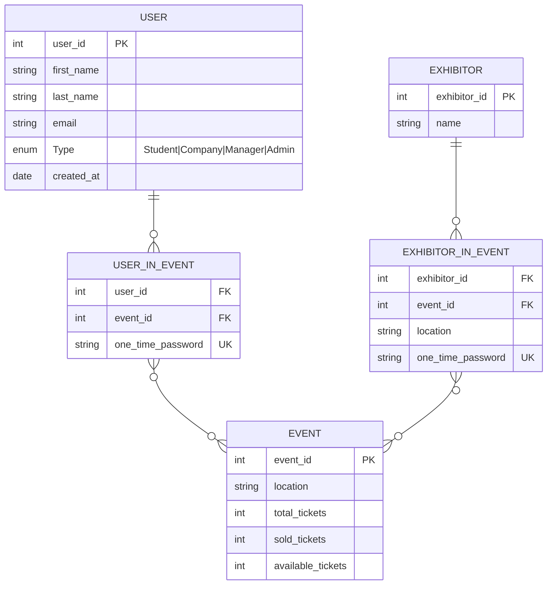

<div align="center">
  <h1>Event Planning</h1>
  
[](https://nestjs.com/)
[](https://nextjs.org/)
[](https://react.dev/)
[](https://tailwindcss.com/)
[](https://www.typescriptlang.org/)
[](https://www.postgresql.org/)
[](https://www.prisma.io/)
[](https://redis.io/)
[](https://www.docker.com/)
</div>


## Prerequisites
- Git
- Docker Desktop (with Docker Compose plugin)
- Free local ports: `3000` (frontend) and `3100` (backend)
- Optional for local non-Docker runs: Node.js `22.x` and npm

#Figma
https://www.figma.com/design/j6hPxpGU3xSX1fASU0jWu6/Event-Planing?node-id=0-1&p=f&t=KqyYZG7N5I7vLIkE-0

## Clone the Project
```powershell
git clone --recurse-submodules https://gitlab.hof-university.de/event-planning/infrastructure.git
cd Event-Planning
```

## Start the Project
### Development mode (hot reload)
```powershell
docker compose -f docker-compose.dev.yml up --build
```
- Frontend: `http://localhost:3000`
- Backend: `http://localhost:3100`

### Production mode
```powershell
docker compose up --build
```
- Frontend: `http://localhost:3000`
- Backend: `http://localhost:3100`


## Diagrams
### ER-Diagram
